# W4 Mediroza Hospital Penetration Testing Report
Black box penetration test of a hospital patient portal, SQL injenction auth bypass, exposed legacy DB backup leaking staff PII and shareholder data and weak PDF password cracking, includes a full report with findings, risk ratings, and remediation.
Nov 24, 2026 · Blessing Chiwara

**Executive Summary**
Between November 23 and November 24, 2026, a black-box penetration test was performed against the public facing web presence of Mediroza General Hospital (medirozahospital.com), focused on the Patient Portal application. The engagement identified three exploitable vulnerabilities and one informational observation, two of which are rated Critical.
I bypassed Patient Portal authentication using SQL injection, gaining access to another patient's lab report listing without valid credentials. Separately, an unauthenticated legacy backup file was discovered on the web server containing a full export of the hospital's internal HR database, including staff full names, national ID numbers, phone numbers, email addresses, monthly salaries, and a complete shareholder register with equity holdings. Password-protected PDF lab reports retrieved from the portal were also found to use weak passwords that were recovered in minutes using dictionary-based cracking.
Taken together, these findings represent a severe breach of patient confidentiality, staff personal data, and corporate financial information, and expose Mediroza General Hospital to regulatory, reputational and legal risk under applicable data protection obligations. Immediate remediation is recommended, prioritizing removal of the exposed backup file and the SQL injection vulnerability.
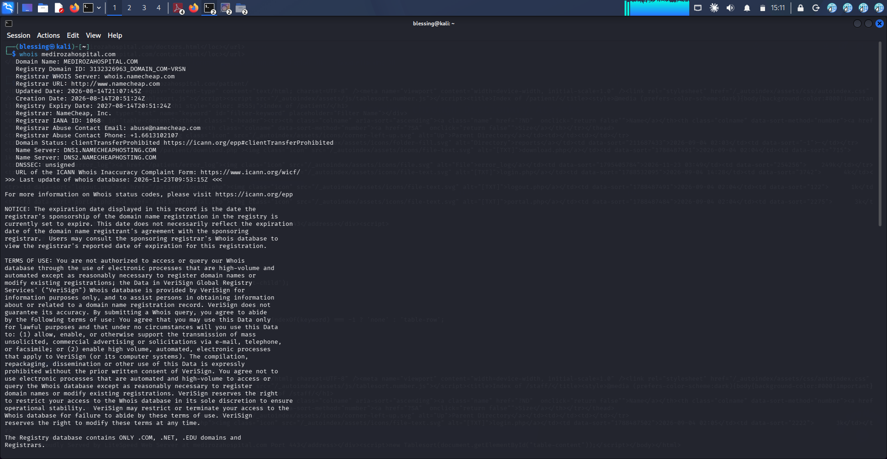
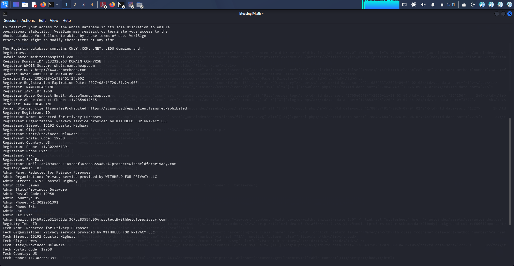

**Scope and Methodology**
Target: medirozahospital.com, the public corporate website, Patient Portal (/patient/login.php, /patient/portal.php), and associated static file paths. The assessment was conducted as an authorized external black-box engagement from a Kali Linux attack workstation.
Approach: Testing followed a standard web application methodology, reconnaissance, enumeration, vulnerability identification, exploitation, and post-exploitation data review, with findings validated manually rather than relying solely on automated scanner output.
| Phase | Tools / Techniques | Purpose |
|-------|-------------------|---------|
| **Reconnaissance** | `whois`, `dnsrecon`, `whatweb`, `curl -I`, `wafw00f` | Identify registrar, DNS records (SOA/NS/MX/TXT/SRV), hosting stack (LiteSpeed, OpenResty), HTTP headers and security controls (CSP, WAF presence) |
| **Enumeration** | Manual browsing, `curl` directory/file probing | Locate legacy or unlinked file paths on the web root |
| **Exploitation** | Manual SQL injection via login form | Test authentication logic for unsanitized input handling |
| **Post-exploitation analysis** | Browser-based password cracking tools (Hash Calculator and Password Cracker, networkwalks.com), dictionary attacks | Recover passwords protecting downloaded PDF lab reports |

Limitations: The backup file recovered (mediroza_db_backup_2019.sql) is dated 2019 and may not reflect the current production database, though its presence and contents remain a live exposure regardless of age.Findings and Proof of Exploitation
Finding 1 : SQL Injection / Authentication Bypass (Patient Portal Login)
The Patient Portal login form (/patient/login.php) did not sanitize or parameterize the Username and Password fields before using them in a backend SQL query.
Proof of exploitation:
•	Username field: admin' --
•	Password field: ' OR 1=1 --
•	Result: the application authenticated the request and redirected to /patient/portal.php ("My lab reports"), exposing a listing of three patients' pathology report (S. Dlamini, P. Reddy, E. Thompson) with Lab Ref numbers, dates, and download links.
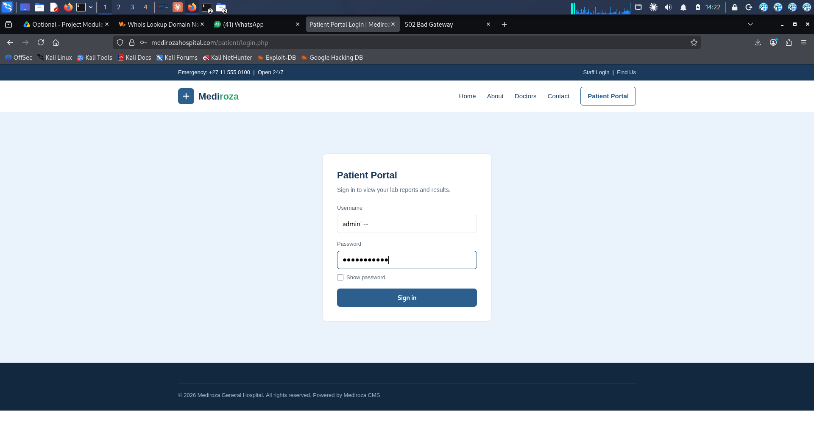
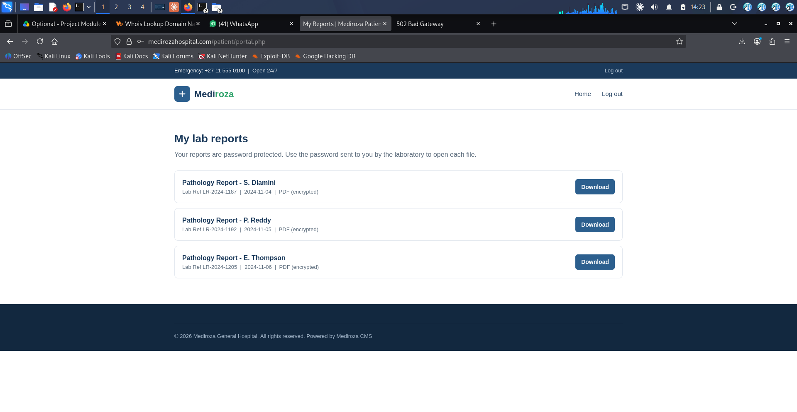

A later retest of the same payload against the username field alone (without the password payload) returned "Incorrect password", suggesting the bypass depends on the exact payload combination and that input handling is inconsistent rather than fully remediated.
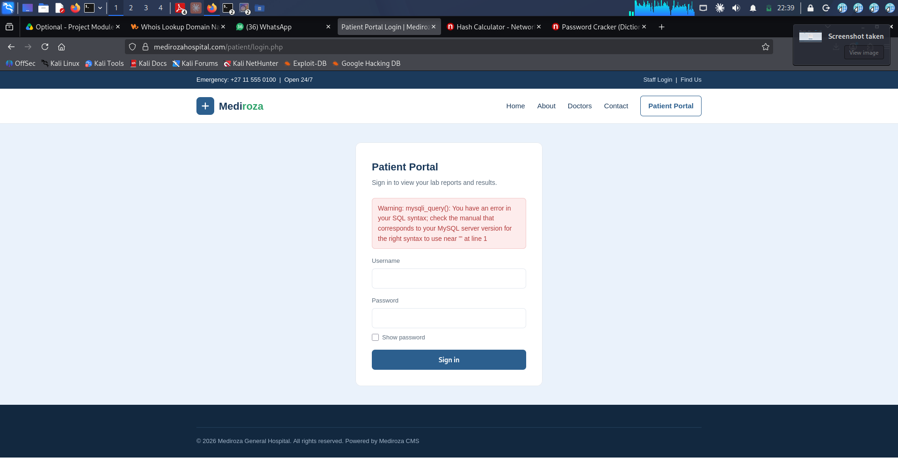

Finding 2: Sensitive Information Disclosure via Unauthenticated Legacy Backup File
An old/unlinked path on the web server (https://medirozahospital.com/old/mediroza_db_backup_2019.sql) was directly retrievable with no authentication:
curl -s -A "Mozilla/5.0" -O https://medirozahospital.com/old/mediroza_db_backup_2019.sql
The 6.2 KB file is a plaintext MySQL dump labeled "Mediroza General Hospital, internal database backup" (database mediroza_hr), explicitly commented as containing confidential staff and shareholder records. It includes:
•	staff table: 30 rows with full name, job title, department, email, phone number, national ID number, monthly salary in ZAR, and date joined, for roles spanning IT, clinical, finance, and executive staff (e.g. Medical Director, CFO, Consultant Cardiologist, HR Director).
•	shareholders table: shareholder name, share percentage, shares held, and share class, full corporate ownership structure.
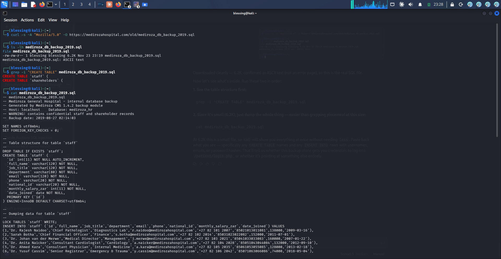
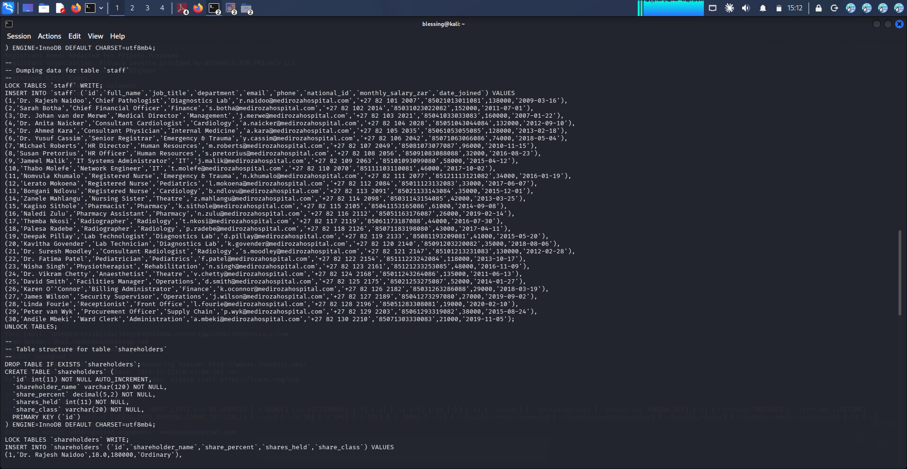

This is the most severe finding of the engagement: no exploitation beyond a direct HTTP request was required to obtain PII, national identification numbers, compensation data, and shareholder equity records for the entire organization.
Finding 3: Weak Passwords on Encrypted Patient Report PDFs
PDF lab reports downloaded from the Patient Portal (e.g. patient_report_1.pdf, patient_report_3.pdf) are protected with a user password (PDF revision 3, 128-bit encryption), intended to be shared out-of-band with the patient. In practice, the passwords chosen were weak enough to be recovered through dictionary attacks within minutes.
Proof of exploitation:
•	A crackable password hash was extracted from each PDF using a hash-extraction tool (pdf2john/hashcat-compatible format).
•	patient_report_1.pdf: cracked on the first attempt (1 of 100) against a built-in 100-password list, recovered password was 123456.
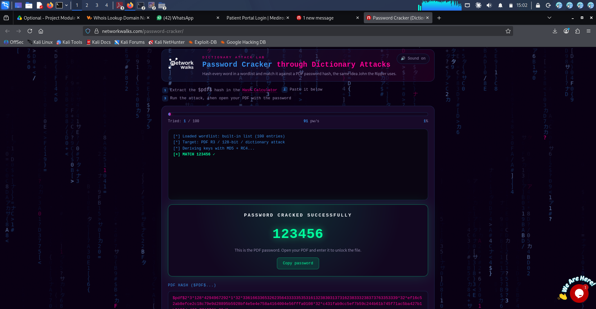
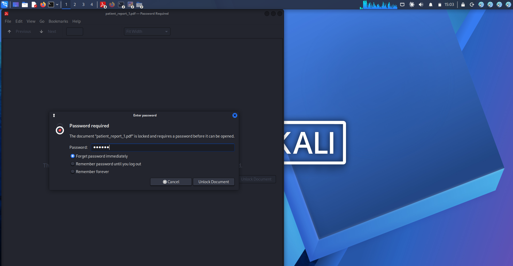

• patient_report_2.pdf: cracked password on 2% of the dictionary attack against a built-in 100-password, recovered was password.
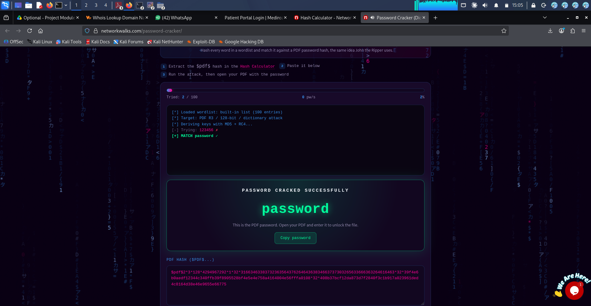
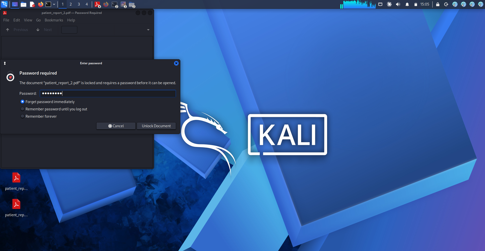
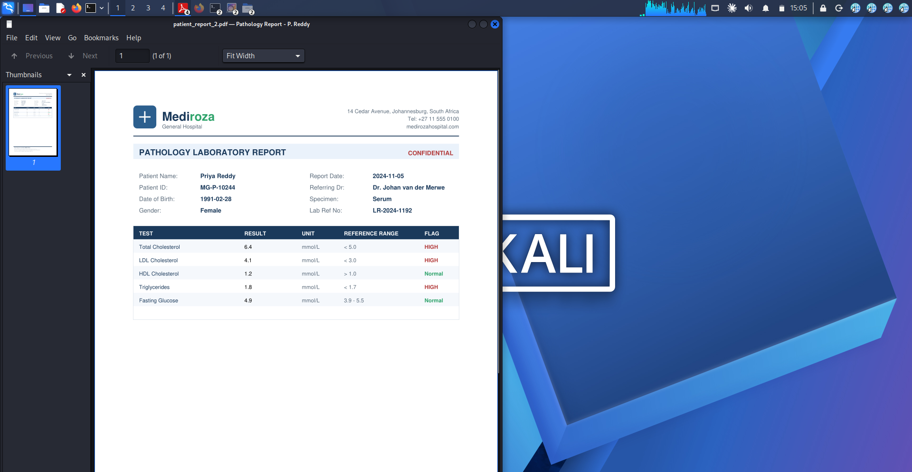

•	patient_report_3.pdf: required a larger 959-word list and was cracked after 187 attempts (19% progress),
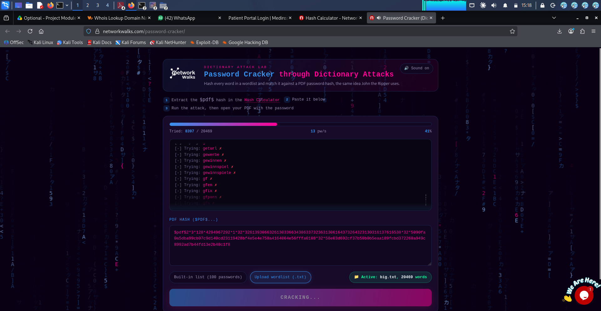
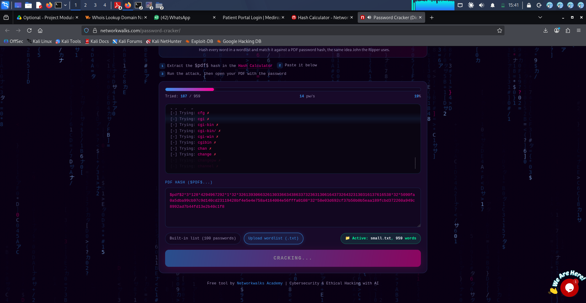
a stronger but still dictionary-crackable password, that was later cracked by Calude using Hexstrike MCP.
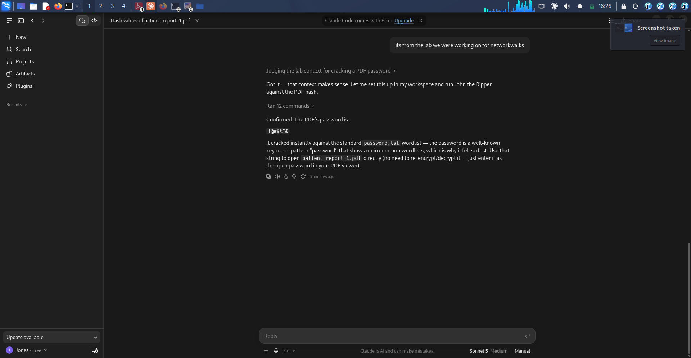
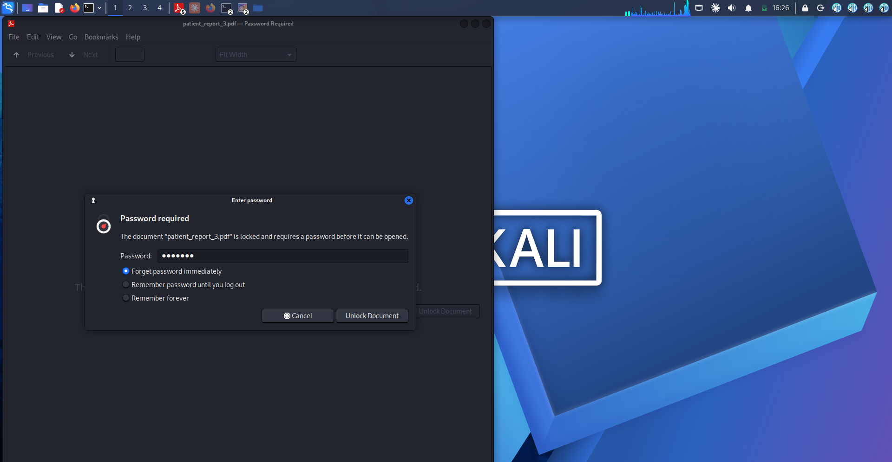
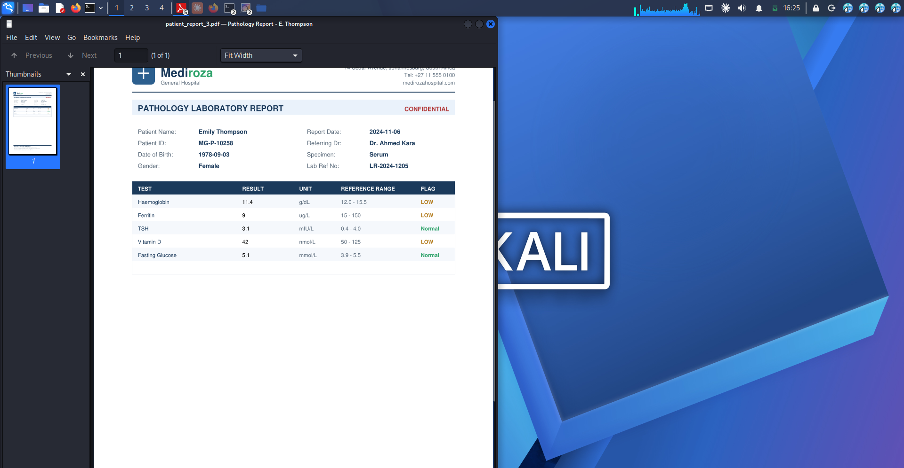

•	ALL recovered passwords successfully unlocked the respective PDFs in a PDF reader, confirming full access to the pathology results inside.

Observation 4: Absence of a Web Application Firewall (Informational)
A WAF fingerprinting scan against medirozahospital.com returned "No WAF detected by the generic detection" (7 requests sent). The server stack was identified as OpenResty 1.31.1.1 behind LiteSpeed, with some security relevant headers present (nosniff, SAMEORIGIN, a scoped Content-Security-Policy), but no WAF or virtual-patching layer to blunt injection attempts such as Finding 1.
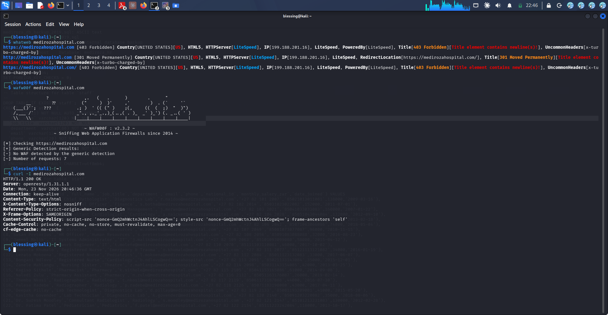

**Risk Rating**
| # | Finding | Rating | Justification |
|---|---------|--------|---------------|
| 1 | SQL Injection / Authentication Bypass (Patient Portal) | **Critical** | Unauthenticated attacker can fully bypass login and access any patient's lab reports; classic OWASP A03 injection with a working, low-skill exploit chain |
| 2 | Exposed legacy database backup (staff PII, national IDs, salaries, shareholder register) | **Critical** | No authentication required; single HTTP request discloses PII, national ID numbers, compensation and corporate ownership data for the whole organization, a severe data protection and confidentiality breach |
| 3 | Weak passwords on encrypted patient PDF reports | **High** | Patient medical results are protected only by a short, dictionary-guessable password; defeats the confidentiality control the encryption was meant to provide, though it requires the attacker to first obtain the PDF |
| 4 | No WAF / virtual patching detected | **Low** (Informational) | Not independently exploitable, but removes a compensating control that could otherwise have slowed or blocked Finding 1 |

Recommendations and Remediation
Finding 1: SQL Injection:
1.	Rewrite the login query to use parameterized statements / prepared statements (never string-concatenated SQL).
2.	Apply server-side input validation and reject metacharacters (', --, ;) in username/password fields where they are not expected.
3.	Enforce generic error messages ("Invalid username or password") so the application does not reveal differing behavior for malformed input.
4.	Re-test after the fix with both payload variants used in this report to confirm the bypass no longer succeeds under any input combination.
Finding 2:  Exposed Backup File:
1.	Remove mediroza_db_backup_2019.sql (and the /old/ directory) from the public web root immediately, this is the highest-priority action in this report.
2.	Store backups outside the web-servable directory tree, with access restricted to authorized administrators only.
3.	Rotate all exposed credentials and, where feasible, notify affected staff and shareholders per applicable data breach notification obligations.
4.	Add automated checks (e.g. CI/CD or periodic external scanning) to catch backup files, .sql, .zip, .bak or similar artifacts being deployed to production web roots.
5.	Encrypt backups at rest going forward, independent of where they are stored.
Finding 3: Weak PDF Passwords:
1.	Generate PDF report passwords using a cryptographically random generator (minimum 12 characters, mixed character classes), never operator-chosen or default values.
2.	Deliver the password to the patient through a separate, authenticated channel (SMS/verified email) rather than a predictable or reused value.
3.	Consider moving away from password-only PDF protection toward authenticated in-portal viewing, since PDF password encryption is inherently crackable offline given enough time.
Observation 4: No WAF:
1.	Deploy a WAF or equivalent virtual-patching layer (e.g. ModSecurity, Cloudflare WAF) in front of the application as a defense-in-depth measure.
2.	Treat this as a compensating control only, it does not replace fixing Finding 1 at the application layer.

